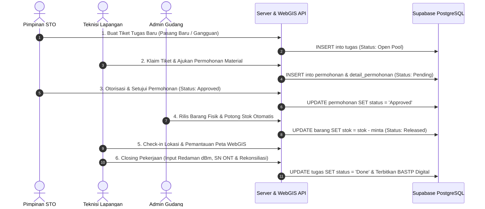

# Perancangan Sistem Informasi Manajemen Teknisi dan Inventaris Gudang Berbasis WebGIS
## STO Telkom Akses (Payakumbuh)

Sistem Operasional Terintegrasi: Monitoring Penugasan Lapangan, Pemetaan Aset Jaringan Fiber Optic WebGIS, Manajemen Logistik Gudang, dan Berita Acara Digital (BASTP).

---

## Akun Login Sistem (Demo & Pengujian)

| Role Pengguna | Email Login | Kata Sandi | Akses Utama |
|---|---|---|---|
| **Pimpinan** | `pimpinan@gmail.com` | `123456` | Command Center, Disposisi Tiket, Approval Logistik, WebGIS, Audit BASTP |
| **Teknisi** | `teknisi@gmail.com` | `123456` | Ambil Tiket Siaga, Permohonan Material, Check-in Lokasi, Closing & BASTP |
| **Gudang** | `gudang@gmail.com` | `123456` | Master Inventaris Barang, Rilis Fisik Material (Potong Stok Otomatis) |

---

## Struktur Project

```
sto-pyk/
├── sto-backend/     → Node.js (Express API) + Supabase (PostgreSQL Cloud)
└── sto-frontend/    → React 19 (Vite), Tailwind CSS, Leaflet WebGIS
```

---

## Cara Menjalankan Project di Lokal

### 1. Prasyarat
- Node.js versi 18 atau lebih baru.
- Koneksi internet aktif untuk sinkronisasi Supabase Cloud.

### 2. Instalasi Dependensi
Jalankan perintah ini di root folder:
```bash
npm run install:all
```
*Perintah ini otomatis menginstal dependensi root, backend, dan frontend sekaligus.*

### 3. Konfigurasi Environment (`.env`)
Pastikan file `.env` telah disiapkan:
- `sto-backend/.env` (Port, URL Supabase, Key Database)
- `sto-frontend/.env` (VITE_SUPABASE_URL, VITE_SUPABASE_ANON_KEY)

### 4. Menjalankan Server
Buka 2 terminal terpisah atau jalankan script:

**Terminal 1 — Backend API:**
```bash
npm run dev:backend
```
*Aktif di: `http://localhost:5000`*

**Terminal 2 — Frontend UI:**
```bash
npm run dev:frontend
```
*Aktif di: `http://localhost:5173`*

---

## 6 Alur Kerja Operasional (SOP Sistem Telkom Akses)



---

## Fitur Utama Sistem

1. **WebGIS Infrastruktur Fiber Optic (Payakumbuh)**:
   - Pemetaan titik persebaran ODP (Optical Distribution Point) berbasis Leaflet Canvas (akselerasi hardware GPU).
   - Indikator kapasitas port ODP (Tersedia, Hampir Penuh, Penuh, Maintenance).

2. **Rekonsiliasi Material Lapangan & BASTP Digital**:
   - Pencatatan pemakaian riil kabel Dropcore dan perangkat Modem ONT (Serial Number Barcode) dengan status resmi **TERPASANG DI PELANGGAN (CONSUMED)**.
   - Sisa kabel yang tidak terpakai dapat di-retur kembali ke gudang.
   - Penerbitan otomatis Berita Acara Serah Terima Pekerjaan (BASTP) digital yang siap dicetak.

3. **Performa Ringan & Anti-Lag (Low-End Friendly)**:
   - Dynamic Route Lazy-Loading & vendor chunking (initial JS load ~340 kB).
   - Kompresi foto dokumentasi kamera client-side otomatis (WebP Canvas Engine max 1280px).
   - Asynchronous storage sync & perlindungan Global Error Boundary.

---

## Tech Stack
- **Backend**: Node.js, Express.js, Supabase JS Client, PostgreSQL Cloud
- **Frontend**: React 19, Vite, Tailwind CSS, React Router, Lucide Icons
- **Peta Geospasial**: Leaflet.js (PreferCanvas Mode)
- **Database**: Supabase PostgreSQL Cloud
